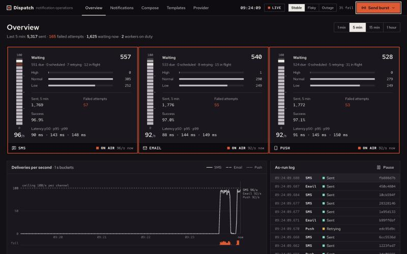
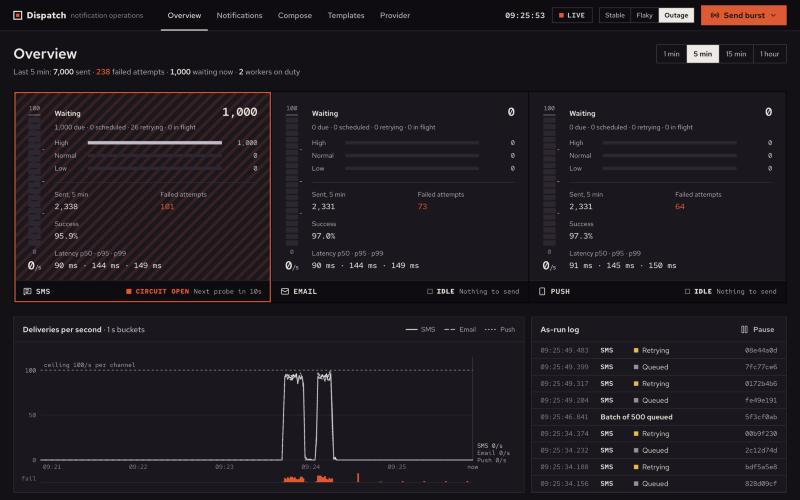
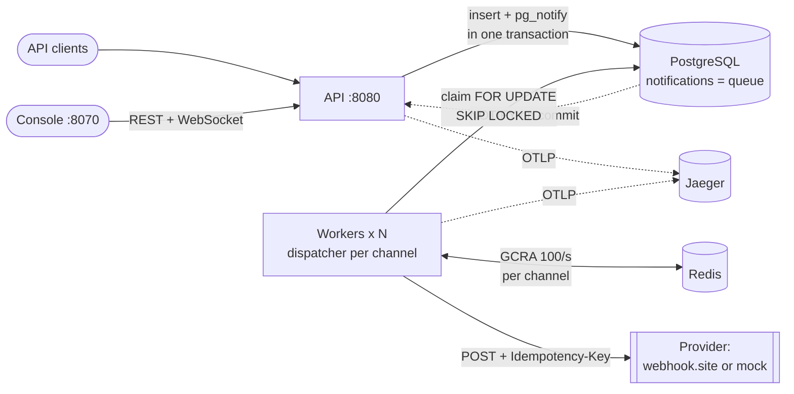
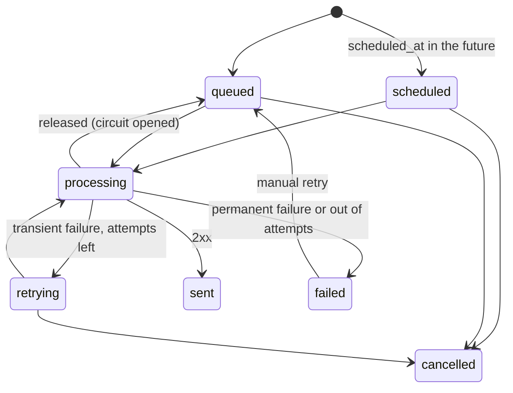
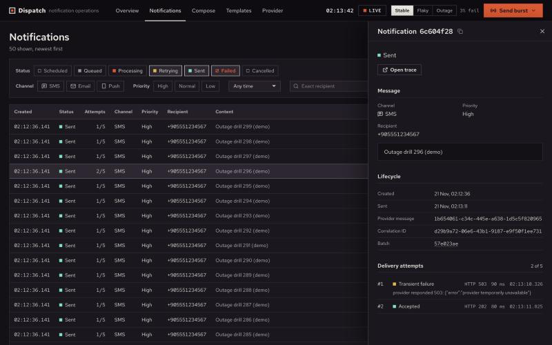
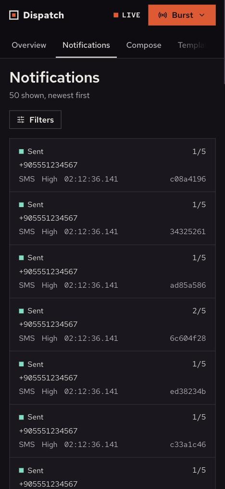

# Notification System

An event-driven notification service for SMS, email and push, written in Go.

The API accepts notifications one at a time or in batches of up to 1,000 and stores them in
PostgreSQL. The same table doubles as the priority queue. Horizontally scalable workers
deliver them through an external provider, at most **100 messages per second per channel**.
Delivery includes retries with backoff, a circuit breaker per channel and idempotency keys.
Status changes stream live over WebSocket, and every request can be followed through
structured logs, metrics and distributed traces.

An operator console (React + TypeScript) shows the whole pipeline working in real time.

Built for the Insider One software engineer assessment.



<sub>The console during a 1,000-notification burst. Each channel's monitor reads its live rate against the 100/s ceiling; the plot and the as-run log come from the same running system.</sub>

## Contents

- [Quick start](#quick-start)
- [Requirements mapped to the code](#requirements-mapped-to-the-code)
- [Architecture](#architecture)
- [Delivery, retries and failure handling](#delivery-retries-and-failure-handling)
- [API](#api)
- [Testing](#testing)
- [Observability](#observability)
- [The operator console](#the-operator-console)
- [Configuration](#configuration)
- [Project layout](#project-layout)
- [Design patterns](#design-patterns)
- [Trade-offs and next steps](#trade-offs-and-next-steps)
- [AI-assisted development](#ai-assisted-development)

## Quick start

You only need Docker with Compose v2.

```bash
docker compose up --build
```

On the first run Docker builds the images. After that, everything starts in a few seconds,
in dependency order with health checks: PostgreSQL, Redis, the migration job, the API, two
workers, the mock provider, Jaeger and the console.

| What | Where |
|---|---|
| Operator console | http://localhost:8070 |
| API and Swagger UI | http://localhost:8080/docs |
| OpenAPI spec | http://localhost:8080/openapi.yaml |
| Traces (Jaeger) | http://localhost:16686 |
| Mock provider statistics | http://localhost:8090/admin/stats |
| Prometheus metrics | http://localhost:8080/metrics |

`make up` does the same in the background and prints these links. `make down` stops
everything and deletes the data.

### Try it in two minutes

1. **Watch the rate limit.** Open the console and choose **Send burst → 1,000 mixed**. All
   three channel monitors light up, and their level meters sit at the 100/s ceiling while
   the queue drains: 333 messages per channel take about 3.3 seconds. Two workers share the
   limit through Redis.
2. **Break the provider.** Switch the provider to **Outage** in the top bar and send
   **500 SMS, high**. After five consecutive failures the SMS circuit opens: the monitor shows
   *Circuit open* and the time of the next probe, and notifications wait in the queue instead
   of burning their retry budget. Email and push are unaffected.
3. **Recover.** Switch back to **Stable**. The circuit lets a single probe through, closes, and
   the backlog drains. Retried notifications show `#2` and `#3` in the as-run log.
4. **Follow one notification.** Click any line of the as-run log. The detail panel lists every
   delivery attempt with its HTTP status and latency. **Open trace** shows the API request,
   the worker's delivery and the provider call as one trace in Jaeger.



The same flows work from a terminal: `make demo` sends a mixed burst, and
`./scripts/smoke.sh` checks the API and the console, then delivers one notification end to
end.

### Using webhook.site as the provider

By default the workers deliver to the bundled mock provider. It answers exactly like the
webhook.site endpoint described in the brief, works offline, and can inject failures. To
deliver to webhook.site instead:

1. Open [webhook.site](https://webhook.site) and copy your unique URL.
2. Under **Edit**, set the default response: status `202`, content type `application/json`,
   body `{"messageId": "6f1c...", "status": "accepted", "timestamp": "2026-11-21T09:00:00Z"}`.
3. Start the stack with that URL. Either export it, or put `PROVIDER_URL=...` in a `.env`
   file (see [`.env.example`](.env.example)):

   ```bash
   PROVIDER_URL=https://webhook.site/your-uuid docker compose up --build
   ```

Every request then shows up on webhook.site with its `Idempotency-Key` (the notification ID)
and `X-Correlation-ID` headers. Step 2 is optional: any `2xx` counts as accepted, and the
custom body only adds the provider's `messageId` to each notification. Free webhook.site
URLs accept a limited number of requests, so keep big bursts for the mock provider.

## Requirements mapped to the code

| Requirement | Where and how |
|---|---|
| Create notifications with recipient, channel, content and priority | `POST /api/v1/notifications`. Validation lives in [`internal/domain`](internal/domain); the use case is in [`internal/service/notifications.go`](internal/service/notifications.go). |
| Batches of up to 1,000 | `POST /api/v1/batches`. Atomic: every invalid item is reported with its index, and the items are inserted with a single `INSERT ... SELECT FROM unnest(...)` statement. |
| Query by notification ID or batch ID | `GET /api/v1/notifications/{id}`, `GET /api/v1/batches/{id}` (counts per status), `GET /api/v1/batches/{id}/notifications` |
| Cancel pending notifications | `POST /api/v1/notifications/{id}/cancel` and `POST /api/v1/batches/{id}/cancel`. A conditional update makes cancellation safe even if a worker is claiming the same row. |
| Listing with filters and pagination | `GET /api/v1/notifications?status=&channel=&priority=&created_from=&created_to=&recipient=&batch_id=&limit=&cursor=`. Keyset cursors stay correct while new notifications arrive. |
| Asynchronous processing by queue workers | [`cmd/worker`](cmd/worker) and [`internal/delivery`](internal/delivery): one dispatcher and a bounded worker pool per channel |
| Rate limit of 100 messages per second per channel | [`internal/ratelimit`](internal/ratelimit): GCRA evaluated atomically in Redis and shared by every worker ([ADR 2](docs/adr/0002-shared-rate-limit-with-gcra.md)) |
| Priority queue (high, normal, low) | The claim query orders by `priority_rank` over a partial index ([ADR 1](docs/adr/0001-postgresql-as-the-queue.md)) |
| Content validation | Per-channel rules in [`internal/domain/policy.go`](internal/domain/policy.go): recipient format and character limits for SMS (1,600), email (10,000) and push (500) |
| Idempotency | `Idempotency-Key` header or `idempotency_key` field, enforced by a unique index; key reuse with a different payload returns `409`. A batch-level key replays the whole batch. |
| Delivery and retry logic (the candidate's design) | [Delivery, retries and failure handling](#delivery-retries-and-failure-handling), [ADR 3](docs/adr/0003-at-least-once-delivery.md) |
| Real-time metrics: queue depth, success and failure rates, latency | `GET /api/v1/metrics?window=5m` (JSON) and `/metrics` (Prometheus) |
| Structured logging with correlation IDs | `log/slog` JSON. `X-Correlation-ID` is stored with each notification and appears in the worker's log lines for its delivery. |
| Health checks | `/healthz` (liveness) and `/readyz` (dependencies), on both the API and the worker |
| Webhook provider integration | [`internal/provider/webhook`](internal/provider/webhook) posts `{to, channel, content}` and expects `202 {messageId, status, timestamp}` |
| Bonus: failure handling | Circuit breaker, dead-letter state with manual retry, lease recovery after worker crashes, graceful shutdown |
| Bonus: scheduled notifications | `scheduled_at` (up to 30 days ahead) |
| Bonus: templates | `/api/v1/templates` with `{{variable}}` placeholders, rendered when the notification is created, plus a preview endpoint |
| Bonus: WebSocket updates | `GET /api/v1/events`, filterable by notification, batch or channel |
| Bonus: distributed tracing | OpenTelemetry to Jaeger. The trace context is stored with the notification, so the worker continues the API's trace. |
| Bonus: GitHub Actions CI | [`.github/workflows/ci.yml`](.github/workflows/ci.yml): lint, unit, integration and end-to-end tests, console checks, and a `docker compose up` smoke test |
| Deliverable: Docker Compose, one command | [`docker-compose.yml`](docker-compose.yml) |
| Deliverable: OpenAPI specification | [`api/openapi.yaml`](api/openapi.yaml), served at `/docs`; a test keeps it in sync with the router |
| Deliverable: versioned migrations | [`migrations/`](migrations): golang-migrate up/down files, embedded in every binary |
| Deliverable: test suite runnable with one command | `make test`, or `make test-docker` with nothing but Docker installed |

## Architecture



The [architecture guide](docs/architecture.md) covers the full picture: components, the life
of a notification, the lifecycle state machine, the package dependency rule, failure modes
and scaling. These are the decisions that shape the system, each recorded as an ADR:

- **PostgreSQL is both the system of record and the queue** ([ADR 1](docs/adr/0001-postgresql-as-the-queue.md)).
  Accepting a notification is one atomic write, so there is no dual write to a broker and no
  outbox relay to run. Workers claim due rows with `FOR UPDATE SKIP LOCKED` in priority
  order. The brief's ceiling of 100 messages per second per channel (300 in total) is light
  work for PostgreSQL, and the queue sits behind a port so a broker could replace it.
- **One rate limit shared by every worker** ([ADR 2](docs/adr/0002-shared-rate-limit-with-gcra.md)).
  GCRA runs in Redis on Redis' own clock. With a burst of 1, sends are spaced 10 ms apart,
  so the limit holds in every second, not just on average, however many workers run.
- **At-least-once delivery, with duplicates contained** ([ADR 3](docs/adr/0003-at-least-once-delivery.md)).
  Leases with fencing tokens, retries that know which failures are worth retrying, a
  circuit breaker per channel, and the notification ID sent as the provider's idempotency
  key, so a provider that honours it can drop the rare resend.
- **Status events committed with the change** ([ADR 4](docs/adr/0004-transactional-events-with-listen-notify.md)).
  `pg_notify` runs inside the same transaction, so listeners never see a change that was
  rolled back.
- **One error format, mapped in one place** ([ADR 5](docs/adr/0005-errors-as-problem-details.md)).
  RFC 9457 problem details with stable codes and a field-level error for every invalid field.

The Go code follows ports and adapters. `internal/domain` has no infrastructure
dependencies. The use cases (`internal/service`) and the delivery engine (`internal/delivery`)
declare the interfaces they need, and the PostgreSQL, Redis and HTTP adapters implement them.
`internal/app` is the composition root that wires everything together, and the end-to-end
tests use those same wiring functions.

## Delivery, retries and failure handling



- **Classify before retrying.** Timeouts, network errors, `408`, `425`, `429` and `5xx`
  responses are transient and get retried. Any other `4xx` is permanent: the notification
  fails at once with the provider's message, instead of wasting four more attempts. A `2xx`
  with an unexpected body still counts as accepted, because resending it would deliver the
  message twice.
- **Back off with jitter.** The wait after attempt *n* is a random duration between half and
  all of `min(5m, 2s × 2^(n-1))`. Notifications that failed together therefore do not come
  back together, and a retry never fires immediately. A longer `Retry-After` from the
  provider wins.
- **Dead letter, with redrive.** After `MAX_ATTEMPTS` (5 by default) a notification is
  `failed`. Failed notifications can be filtered in the API and the console, and
  `POST /retry` puts one back in the queue with a fresh attempt budget.
- **Circuit breaker per channel.** Five consecutive provider failures open the circuit. The
  dispatcher then stops claiming, so waiting notifications keep their attempts. After a
  cooldown a single probe goes through, and its result closes the circuit or reopens it.
  Rejections (`4xx`) count as healthy answers: they prove the provider is up.
- **Bulkheads.** Each channel has its own dispatcher, worker pool, rate limit and breaker,
  so a failing SMS provider never slows email or push.
- **Leases and fencing.** A claim gives the row a `lease_id`. Recording the outcome requires
  that lease, so a worker that stalled past its lease cannot overwrite the worker that took
  over. Expired leases are recovered automatically, and the unknown outcome is written to
  the attempt log.
- **Duplicates.** Within the system, a row is leased to one worker at a time. Towards the
  provider, every request carries `Idempotency-Key: <notification id>`, so a provider that
  supports idempotency drops the rare resend after a crash.
- **Graceful shutdown.** On `SIGTERM`, workers stop claiming, finish the sends already in
  flight and record them. The API drains its open requests.

## API

The full contract is in [`api/openapi.yaml`](api/openapi.yaml), browsable at
http://localhost:8080/docs.

| Method | Path | Purpose |
|---|---|---|
| `POST` | `/api/v1/notifications` | Create a notification (`202`; `200` for an idempotent replay) |
| `GET` | `/api/v1/notifications` | List with filters and cursor pagination |
| `GET` | `/api/v1/notifications/{id}` | Get a notification |
| `GET` | `/api/v1/notifications/{id}/attempts` | Delivery attempt history |
| `POST` | `/api/v1/notifications/{id}/cancel` | Cancel a waiting notification |
| `POST` | `/api/v1/notifications/{id}/retry` | Requeue a failed notification |
| `POST` | `/api/v1/batches` | Create up to 1,000 notifications atomically |
| `GET` | `/api/v1/batches/{id}` | Batch progress: counts per status |
| `GET` | `/api/v1/batches/{id}/notifications` | The batch's notifications |
| `POST` | `/api/v1/batches/{id}/cancel` | Cancel every waiting notification of a batch |
| `POST`, `GET` | `/api/v1/templates` | Create and list templates |
| `GET`, `PUT`, `DELETE` | `/api/v1/templates/{id}` | Read, replace and delete a template |
| `POST` | `/api/v1/templates/{id}/preview` | Render a template without sending |
| `GET` | `/api/v1/metrics?window=5m` | Metrics snapshot |
| `GET` | `/api/v1/events` | WebSocket stream of status changes |
| `GET` | `/healthz`, `/readyz`, `/metrics` | Liveness, readiness, Prometheus |

**Create a notification**, made safe to retry with an idempotency key:

```bash
curl -s -X POST localhost:8080/api/v1/notifications \
  -H 'Content-Type: application/json' \
  -H 'Idempotency-Key: order-1042-shipped' \
  -d '{"channel": "sms", "recipient": "+905551234567", "content": "Your order #1042 has shipped.", "priority": "high"}'
```

```json
{
  "id": "01a1fcbb-5a07-74fa-acfe-f5db8cf90c20",
  "channel": "sms",
  "priority": "high",
  "recipient": "+905551234567",
  "content": "Your order #1042 has shipped.",
  "status": "queued",
  "idempotency_key": "order-1042-shipped",
  "attempts": 0,
  "max_attempts": 5,
  "next_attempt_at": "2026-11-21T06:11:39.143326Z",
  "correlation_id": "75b88626-fd59-411c-9097-b457b39713f5",
  "trace_id": "492c9513493d02a8447b563eef7fd104",
  "created_at": "2026-11-21T06:11:39.143326Z",
  "sent_at": null
}
```

(Abbreviated. Absent values are explicit `null`s.) Sending the same request again returns
`200` with `Idempotent-Replayed: true` and the same notification. Sending a different
payload under the same key returns `409 idempotency_conflict`.

**Batch, schedule, template:**

```bash
# A batch: accepted whole or rejected whole.
curl -s -X POST localhost:8080/api/v1/batches -H 'Content-Type: application/json' -d '{
  "notifications": [
    {"channel": "email", "recipient": "ada@example.com", "content": "Flash sale: 40% off for 2 hours", "priority": "high"},
    {"channel": "push", "recipient": "fcm:APA91bH-device-token", "content": "Flash sale starts now", "scheduled_at": "2026-11-25T09:00:00Z"}
  ]}'

# A template, then a notification rendered from it.
curl -s -X POST localhost:8080/api/v1/templates -H 'Content-Type: application/json' \
  -d '{"name": "order-shipped", "channel": "sms", "body": "Hi {{name}}, order {{order_id}} has shipped."}'
curl -s -X POST localhost:8080/api/v1/notifications -H 'Content-Type: application/json' \
  -d '{"recipient": "+905551234567", "template_id": "<template id>", "variables": {"name": "Ada", "order_id": "#1042"}}'
```

**Query, cancel, retry:**

```bash
curl -s 'localhost:8080/api/v1/notifications?status=failed,retrying&channel=sms&limit=20'
curl -s 'localhost:8080/api/v1/batches/<batch id>'
curl -s -X POST localhost:8080/api/v1/notifications/<id>/cancel
curl -s -X POST localhost:8080/api/v1/notifications/<id>/retry
curl -s localhost:8080/api/v1/notifications/<id>/attempts
curl -s 'localhost:8080/api/v1/metrics?window=15m'
```

**Errors** are [RFC 9457](https://www.rfc-editor.org/rfc/rfc9457) problem details. Every
invalid field is reported in a single response:

```json
{
  "type": "about:blank",
  "title": "Unprocessable Entity",
  "status": 422,
  "detail": "The request contains invalid fields; see errors for details.",
  "instance": "/api/v1/notifications",
  "code": "validation_failed",
  "request_id": "readme-demo-42",
  "errors": [
    {"field": "priority", "code": "invalid_value", "message": "priority must be one of high, normal, low"},
    {"field": "recipient", "code": "invalid_format", "message": "recipient must be an E.164 phone number such as +905551234567"},
    {"field": "content", "code": "required", "message": "content is required"}
  ]
}
```

Clients branch on the stable `code`: `validation_failed`, `invalid_parameters`,
`invalid_json`, `unsupported_media_type`, `payload_too_large`, `not_found`,
`method_not_allowed`, `not_cancellable`, `not_retryable`, `idempotency_conflict`,
`template_name_taken`, `internal_error`. Unexpected errors return a generic `500` that
carries the `request_id`. The real cause is logged under that ID and never sent to the
client.

## Testing

```bash
make test             # unit + integration + end-to-end, with -race (needs Docker for testcontainers)
make test-unit        # unit tests only, no Docker needed
make test-docker      # the whole suite inside Docker: nothing else needs to be installed
make test-web         # console: type check, lint and tests
make cover            # coverage report in coverage/coverage.html
make lint             # golangci-lint with a curated set of linters
```

| Level | What it proves | Where |
|---|---|---|
| Unit (73 test functions) | The domain rules: the full status transition table, per-channel validation, templates. The services' decisions: idempotent replay and conflict, atomic batches, pagination. The engine: retry classification, backoff bounds, circuit breaker states, concurrency limits, pacing, graceful shutdown. Also the HTTP contract: every error path, strict JSON decoding, query parsing and the WebSocket stream. | `internal/**/*_test.go` |
| Integration (20, against real PostgreSQL and Redis) | Every repository against a real database: concurrent idempotent creates insert exactly once, concurrent claimers never share a row, priority ordering, lease fencing and recovery, cancel-versus-claim races, 1,000-item atomic batches, metrics aggregates, LISTEN/NOTIFY events, and up/down migrations. The Redis rate limit is shared across three limiters. | `*_integration_test.go` (build tag `integration`) |
| End-to-end (7) | The real API and the real delivery engine against PostgreSQL and a recording fake provider: every notification is delivered exactly once, transient failures are retried, permanent failures stop and can be retried by hand, scheduled notifications can be cancelled, idempotency holds over HTTP, the provider receives no more than the limit in any rolling second (allowing one send of timing jitter), and changes stream over WebSocket. | [`test/e2e`](test/e2e/e2e_test.go) |
| Contract | The OpenAPI spec is valid and documents exactly the routes the router serves. In CI, the console's TypeScript types must match the spec. | [`internal/httpapi/openapi_test.go`](internal/httpapi/openapi_test.go) |
| Console (29) | Formatting, SMS segment counting, the tally logic, the event stream's batching, rates and resync, the level meter's accessible values, and the compose form showing server-side validation errors on the right fields. | `web/src/**/*.test.ts(x)` |

All 217 Go test cases (counting subtests) and the 29 console tests pass. The whole Go suite
runs in about 30 seconds. More on the approach is in [docs/testing.md](docs/testing.md).
Highlights:

- **Virtual time.** Timing-sensitive code (rate limiting, dispatching, the engine's
  background loops) is tested with Go's `testing/synctest`, so "101 sends at 100/s take
  exactly one second" is asserted exactly and runs instantly.
- **A real database per test, in milliseconds.** The schema is migrated once into a template
  database. Every test then gets its own copy via `CREATE DATABASE ... TEMPLATE`, so
  integration tests run in parallel without sharing state.
- **Testcontainers or your own servers.** Integration tests start PostgreSQL and Redis
  containers, or use `TEST_DATABASE_URL` and `TEST_REDIS_URL`. That is how `make test-docker`
  runs the suite against the Compose services.
- **Fakes, not mocks.** Small in-memory implementations of the ports keep unit tests about
  behaviour rather than call sequences.

## Observability

**Logs** are JSON (`log/slog`). A context-aware handler stamps every line logged during a
request or a delivery with its correlation ID and its trace and span IDs. The worker's line
for the notification created above carries the same `correlation_id` and `trace_id` as the
API's response:

```json
{"time":"2026-11-21T06:11:39.400982149Z","level":"INFO","msg":"notification delivered",
 "worker_id":"b04195083fe4-2b649304","notification_id":"01a1fcbb-5a07-74fa-acfe-f5db8cf90c20",
 "channel":"sms","priority":"high","attempt":1,"max_attempts":5,"outcome":"success","status":"sent",
 "duration_ms":137.772,"provider_message_id":"4f1bd6e5-06de-4331-b026-9f7fe38dd21a",
 "correlation_id":"75b88626-fd59-411c-9097-b457b39713f5",
 "trace_id":"492c9513493d02a8447b563eef7fd104","span_id":"d8fac862aac9abba"}
```

```bash
docker compose logs worker | grep <correlation id>   # one request, across processes
```

**Metrics:**

- `GET /api/v1/metrics` returns a JSON snapshot, computed from the database so every
  replica agrees. Per channel it reports queue depth by priority and status (with what is due
  now versus scheduled), successes, retryable and permanent failures, success rate,
  throughput, latency p50/p95/p99, the configured ceiling and circuit state. It also
  includes a per-second throughput series and live workers.
- `/metrics` exposes Prometheus metrics: HTTP latency by route,
  `notification_delivery_attempts_total`, `notification_delivery_duration_seconds`,
  `notification_queue_depth` (read at scrape time), `notification_circuit_state`,
  `notification_releases_total` and `notification_leases_recovered_total`.

**Traces** go to Jaeger through OTLP. The API stores each notification's W3C `traceparent`,
so the worker's delivery span joins the trace of the request that created the notification.
One trace runs from the API request through the worker's `deliver sms` span to the outgoing
provider call.

**Health:** `/healthz` reports liveness without checking dependencies, so a database outage
never restarts healthy processes. `/readyz` reports whether PostgreSQL (and Redis, for
workers) answer within two seconds. Docker Compose uses both.

## The operator console



The console in [`web/`](web) is React 19 with TypeScript, TanStack Query and Vite. Its API
types are generated from the OpenAPI spec, and nginx serves it in Compose with the API,
the WebSocket stream and the mock provider's admin API proxied on the same origin. The visual
language is a broadcast control room, in Insider One's colours: colour only marks state, as
tally lamps do in a gallery. Orange means on air, amber means probing, hatched means circuit
open, mint means sent.

- **Overview:** one monitor per channel with a segmented level meter against the 100/s
  ceiling, the queue by priority, outcomes and latency, and the circuit state. Below them
  are a per-second throughput plot and a timecoded *as-run log* of deliveries fed by the
  WebSocket stream. The plot is drawn from the metrics API and ends on the live rate, so
  it always agrees with the meters.
- **Notifications:** filters kept in the URL, cursor pagination, rows that update in place,
  and a detail panel with the attempt timeline, cancel and retry, and a link to the trace.
- **Compose:** single sends with live per-channel limits and SMS segment counting (GSM-7 or
  UCS-2), templates rendered by the server, scheduling and idempotency keys. Also a batch
  generator, with labelled synthetic data.
- **Batch pages, templates and the provider simulator:** stable, flaky or outage. The
  simulator also reports the rate it received, as independent evidence that the limit
  holds.

The console works on a phone too, for whoever is on call away from a desk. The explorer
becomes two-line records, and the filters fold behind a single button.



The product brief and the design direction the console was built against are in
[PRODUCT.md](PRODUCT.md) and [`.impeccable/`](.impeccable). The design system it ships is
recorded in [DESIGN.md](DESIGN.md).

## Configuration

All configuration comes from environment variables. Defaults suit Docker Compose, which
also sets the connection URLs.

| Variable | Default | Used by | Meaning |
|---|---|---|---|
| `DATABASE_URL` | required | API, worker, migrate | PostgreSQL connection URL |
| `DB_MAX_CONNS` | `20` | API, worker | PostgreSQL connection pool size |
| `PROVIDER_URL` | required | worker | Where to deliver; Compose defaults to the mock provider |
| `REDIS_URL` | empty | worker | Enables the shared rate limiter. Without it each worker paces itself, which is only correct for a single worker. |
| `RATE_LIMIT_PER_SECOND` | `100` | API, worker | Per-channel ceiling |
| `RATE_LIMIT_BURST` | `1` | worker | Sends allowed back to back; 1 spaces them evenly |
| `MAX_ATTEMPTS` | `5` | API, worker | Delivery attempt budget |
| `WORKER_CONCURRENCY` | `20` | worker | Deliveries in flight per channel |
| `WORKER_ID` | the hostname | worker | Name used in heartbeats and logs |
| `RETRY_BASE_DELAY`, `RETRY_MAX_DELAY` | `2s`, `5m` | worker | Exponential backoff bounds |
| `BREAKER_THRESHOLD`, `BREAKER_COOLDOWN` | `5`, `15s` | worker | Failures that open a circuit, and how long it stays open |
| `PROVIDER_TIMEOUT` | `5s` | worker | Provider request timeout |
| `LEASE_TTL` | `30s` | worker | How long a claim stays valid; must be at least twice `PROVIDER_TIMEOUT` |
| `POLL_INTERVAL` | `250ms` | worker | Idle wait between queue checks |
| `LEASE_RECOVERY_INTERVAL`, `HEARTBEAT_INTERVAL` | `10s`, `5s` | worker | Background maintenance |
| `HTTP_ADDR` | `:8080` (API), `:9090` (worker) | API, worker | Listen address |
| `WS_ALLOWED_ORIGINS` | `localhost:*,127.0.0.1:*` | API | Origins allowed to open the WebSocket from another host |
| `MIGRATE_ON_START` | `false` | API | Apply migrations at startup (Compose runs a migrate job instead) |
| `LOG_LEVEL`, `LOG_FORMAT` | `info`, `json` | API, worker | Logging |
| `OTEL_EXPORTER_OTLP_TRACES_ENDPOINT` | empty | API, worker | Enables tracing, e.g. `http://jaeger:4318/v1/traces` |
| `OTEL_TRACES_SAMPLE_RATIO` | `1` | API, worker | Trace sampling ratio |
| `SHUTDOWN_TIMEOUT` | `15s` (API), `30s` (worker) | API, worker | Graceful shutdown budget |
| `CONSOLE_PORT`, `WORKER_REPLICAS` | `8070`, `2` | Compose | Console port and number of workers |
| `MOCK_FAILURE_RATE`, `MOCK_MIN_LATENCY_MS`, `MOCK_MAX_LATENCY_MS` | `0.03`, `30`, `150` | mock provider | Starting behaviour; adjustable live from the console |

A process with invalid configuration refuses to start, and its error names the settings at
fault.

## Project layout

```
cmd/                     entrypoints: api, worker, migrate, mockprovider
internal/
  domain/                the model: notifications, status machine, channel rules, templates, errors
  service/               use cases and the ports they need
  delivery/              processing engine: dispatcher, processor, circuit breaker, backoff
  provider/webhook/      HTTP provider client and failure classification
  ratelimit/             local and Redis (GCRA) rate limiters
  storage/postgres/      repositories, queue, metrics, events, migrations runner
  httpapi/               REST API, WebSocket, problem details, middleware
  realtime/              WebSocket fan-out hub
  observability/         logging, tracing; metrics/ for Prometheus
  mockprovider/          the provider simulator
  config/                environment configuration
  app/                   composition root
  testutil/              per-test PostgreSQL databases and Redis for integration tests
migrations/              versioned SQL migrations, embedded
api/openapi.yaml         the API contract
test/e2e/                end-to-end tests through the HTTP API
web/                     the operator console
docs/                    architecture guide, ADRs, testing, AI usage
```

## Design patterns

Each pattern is used where it solves a concrete problem. The
[architecture guide](docs/architecture.md#design-patterns-where-they-earn-their-place)
explains each one.

| Pattern | Used for |
|---|---|
| Ports and adapters, repository | Use cases and the delivery engine never see SQL, HTTP or Redis; every adapter can be replaced by a fake |
| Strategy | Per-channel validation (`ChannelPolicy`), retry policy, local versus Redis rate limiting |
| State machine | Notification lifecycle; the circuit breaker's closed, open and half-open states |
| Circuit breaker and bulkhead | Stop calling a failing provider; isolate channels from each other |
| Dispatcher and worker pool | Bounded concurrency per channel, claiming only what can be sent now |
| Lease with fencing token | Safe recovery from crashed or stalled workers |
| Decorator | HTTP middleware, the traced provider transport, the context-aware log handler |
| Adapter | Error-returning handlers turned into `http.HandlerFunc`, with errors mapped in one place |
| Observer (publish/subscribe) | The WebSocket hub; Prometheus metrics as the engine's `Observer` |
| Functional options, composition root | Readable construction with test seams; dependency injection without a framework |

## Trade-offs and next steps

- **PostgreSQL as the queue** keeps the system consistent and simple at the brief's 300
  msg/s ceiling. At tens of thousands per second, a broker would take over behind the
  existing `delivery.Store` port, with an outbox for the dual write ([ADR 1](docs/adr/0001-postgresql-as-the-queue.md)).
- **Strict priority** can starve low-priority work under sustained high-priority load. That
  is what the brief asks for; weighted fair dequeueing would be a change to one query.
- **Queue depth uses `count(*)`.** That is fine for this scale; with millions waiting it
  should become maintained counters.
- **NOTIFY events are not replayed** after a reconnect. Clients resync from the API, and the
  database stays the source of truth ([ADR 4](docs/adr/0004-transactional-events-with-listen-notify.md)).
- **Not in scope:** authentication and multi-tenancy (API keys or OAuth per tenant), rate
  limits per tenant, data retention, and per-channel provider URLs. Each fits behind an
  existing seam.

## AI-assisted development

This project was built with Claude Code as a pair programmer. Product and design decisions
went through explicit questions and answers, and every change was verified by the test
suite, the linters and the running stack before it was committed. Each commit says so in a
`Co-Authored-By` trailer. [docs/ai-usage.md](docs/ai-usage.md) describes the workflow:
what was delegated, what was decided by hand, and how the output was checked.
