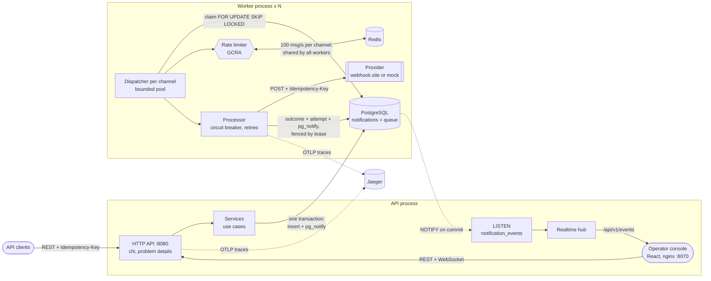
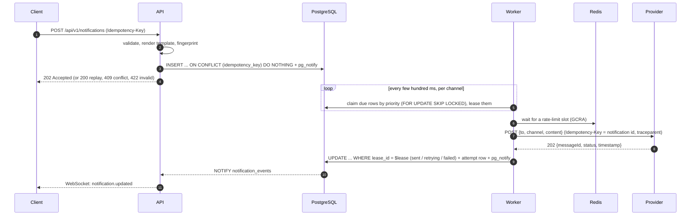
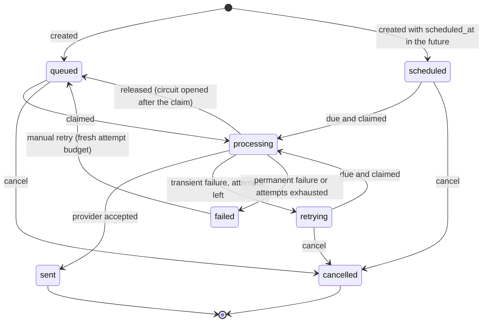

# Architecture

This document explains how the notification system is put together and why. The README
has the short version; the decisions themselves are recorded in [`docs/adr`](adr).

## Components



| Process | Binary | Responsibility |
|---|---|---|
| API | `cmd/api` | Validates and stores notifications, serves queries, metrics, health, docs and the WebSocket stream. Stateless; scale horizontally. |
| Worker | `cmd/worker` | Claims due notifications, paces them per channel, delivers, records outcomes, retries, recovers expired leases, reports heartbeats. Scale horizontally. |
| Migrate | `cmd/migrate` | Applies the embedded, versioned SQL migrations, then exits. |
| Mock provider | `cmd/mockprovider` | Local stand-in for webhook.site with latency, failure and outage injection. |
| Console | `web/` | Operator UI (React + TypeScript), served by nginx that also proxies the API. |

## Life of a notification



## Lifecycle



The table in `domain.Status` encodes the same transitions, and a unit test checks the full
cross product so an accidental new transition fails the build. Storage enforces them with
conditional updates (`WHERE status IN (...)`), which is what makes cancellation safe against
a worker claiming the same row at the same moment: exactly one of the two wins.

## Packages and the dependency rule

```
domain      pure model: Notification, Status machine, ChannelPolicy, Template, errors
service     use cases + the ports they need (repositories)        imports domain
delivery    processing engine + its ports (Store, Limiter, ...)   imports domain, provider
provider    the provider contract (Sender, Message, Error)        imports domain
  webhook   HTTP adapter for webhook.site and the mock            implements provider.Sender
ratelimit   Local and Redis limiters                              implements delivery.Limiter
storage/postgres   repositories, queue, metrics, events, migrations   implements the ports
httpapi     REST, WebSocket, problem details, middleware          imports service, domain
realtime    WebSocket fan-out hub                                 imports domain
observability  slog context handler, tracing; metrics/ Prometheus
app         composition root: the only package that knows every concrete type
```

Dependencies point inwards: `domain` imports nothing of ours, use cases depend on interfaces
they declare themselves, and adapters implement those interfaces. Tests replace any adapter
with a fake, and the end-to-end suite uses the same wiring functions (`app.BuildAPI`,
`app.BuildEngine`) as the real binaries.

## Design patterns, where they earn their place

| Pattern | Where | Why it is there |
|---|---|---|
| Ports and adapters (hexagonal) | `service/ports.go`, `delivery/ports.go`, `storage/postgres`, `provider/webhook`, `ratelimit` | Use cases and the engine never see SQL, HTTP or Redis; every adapter is replaceable and fakeable. |
| Repository | `postgres.NotificationRepository`, `BatchRepository`, `TemplateRepository` | One place owns each aggregate's SQL, including the atomic idempotent insert. |
| Strategy | `domain.ChannelPolicy` (per-channel validation), `delivery.RetryPolicy`, `delivery.Limiter` (Local vs Redis) | Rules that vary per channel or deployment are swappable values, not `if` chains. |
| State machine | `domain.Status` transitions; `delivery.CircuitBreaker` (closed, open, half-open) | Explicit, tested transitions instead of status checks scattered across the code. |
| Circuit breaker | `delivery.CircuitBreaker`, consulted by dispatcher and processor | Stops hammering a failing provider and lets it recover; probes with one request. |
| Bulkhead | One dispatcher, worker pool, rate limit and breaker per channel | A failing SMS provider cannot starve email or push. |
| Dispatcher / worker pool | `delivery.Dispatcher` with a slot semaphore | Bounded concurrency; claims only what can be sent now, so leases stay short. |
| Lease + fencing token | `lease_id` on claim, checked on completion | A stalled worker cannot overwrite the worker that took over its notification. |
| Decorator | HTTP middleware (correlation ID, panic recovery, logging/metrics); `otelhttp` around the provider transport; slog `contextHandler` | Cross-cutting concerns wrap the core without touching it. |
| Adapter | `API.handle` turns error-returning handlers into `http.HandlerFunc` | One place maps errors to responses (see ADR 5). |
| Observer / publish-subscribe | `realtime.Hub`, `delivery.Observer` (implemented by Prometheus metrics), `pg_notify` events | Producers do not know their consumers; slow subscribers cannot block publishers. |
| Functional options | `webhook.New(url, WithHTTPClient(...))`, `service.WithClock(...)` | Readable construction with safe defaults; tests inject clocks and IDs. |
| Composition root | `internal/app` | Dependency injection without a framework; one place shows how everything connects. |

## Failure modes

| What fails | What happens | Recovery |
|---|---|---|
| API process dies | Accepted notifications are already committed; in-flight requests fail and clients retry them with the same `Idempotency-Key`, getting the original result. | Restart; nothing to repair. |
| Worker dies mid-delivery | Its leases expire (30 s). Another worker's lease recovery requeues the notifications, records the lost attempt as "outcome unknown", or fails them if it was their last attempt. | Automatic. The provider sees the same `Idempotency-Key` if it is resent. |
| Worker stalls past its lease, then wakes up | Its `Complete` matches no row (`lease_id` changed): `ErrLeaseLost`, logged, nothing overwritten. | Automatic. |
| Provider returns 5xx, 429 or times out | Retry with exponential backoff and jitter (or the provider's `Retry-After`). | Automatic, up to `MAX_ATTEMPTS`; then `failed`, retryable by hand. |
| Provider rejects (4xx) | `failed` immediately with the provider's message in `last_error`. | Fix the input, then `POST /retry` or send a new notification. |
| Provider is down | After 5 consecutive failures the channel's circuit opens; claimed work is released without spending attempts; one probe every cooldown. | Closes automatically when a probe succeeds. Other channels are unaffected. |
| Redis is down | The rate limiter fails closed: the channel pauses and claimed notifications go back to the queue. Readiness reports it. | Resumes when Redis returns. |
| PostgreSQL is down | API answers 500 with a request ID; readiness turns 503; workers back off and retry claims. | Resumes when PostgreSQL returns. |
| WebSocket client too slow | The hub drops it with close code 4000. | The console reconnects and refetches. |
| Event listener loses its connection | Reconnects with exponential backoff; events committed meanwhile are not replayed. | Clients resync after reconnect; the database stays the source of truth. |

## Concurrency and correctness, in one place

- **No double sends from the queue:** `FOR UPDATE SKIP LOCKED` plus the `processing` status
  means a row is leased to exactly one worker (tested with 8 concurrent claimers over 300
  rows).
- **No lost updates:** completion is fenced by `lease_id`; cancellation and retry are
  conditional updates on the current status.
- **No duplicate notifications:** a unique partial index on `idempotency_key` plus
  `ON CONFLICT DO NOTHING` makes concurrent creates with one key insert exactly once (tested
  with 20 concurrent requests); the payload fingerprint turns key reuse with different
  content into a `409`.
- **Rate limit across processes:** GCRA in Redis with Redis' clock (tested with three
  limiter instances and twelve goroutines).
- **Graceful shutdown:** on SIGTERM the API drains requests; workers stop claiming, finish
  the sends already started, record them, and give up after `SHUTDOWN_TIMEOUT`, leaving any
  remainder to lease recovery.

## Scaling notes

The design is sized for the brief's throughput ceiling (300 msg/s in total). Beyond it:

1. Raise the provider limits; the engine's concurrency (`WORKER_CONCURRENCY`) and worker
   count scale delivery linearly until PostgreSQL write throughput becomes the bottleneck.
2. Replace the queue-depth `count(*)` queries with maintained counters before the backlog
   reaches millions of rows.
3. Partition `notifications` and `delivery_attempts` by time and move old rows to cheaper
   storage; the queue only ever touches recent, waiting rows.
4. For tens of thousands of messages per second, put a broker behind `delivery.Store`
   (with an outbox for the dual write); the engine, API and console stay as they are.
